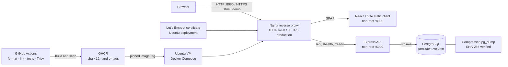

# Architecture Overview

## Runtime and delivery flow

The local HTTPS profile uses a self-signed certificate generated on demand; it is ignored by Git and should be used only for the local demo. Production TLS uses Certbot on the Ubuntu VM. The production Nginx reverse proxy runs unprivileged on container ports 8080/8443; only the host maps public 80/443. Its supplementary group can read the restricted TLS private key.

## Monorepo Layout

- `frontend/`: React + Vite + Tailwind CSS SPA
- `backend/`: Node.js + Express REST API (modular architecture)
- `nginx/`: Reverse proxy configuration for local and production deployment
- `scripts/`: Development and deployment automation scripts
- `docs/`: Technical specifications and runbooks
- `.github/workflows/`: CI/CD pipelines (testing, linting, container builds)

## Backend Layers

1. **Config**: Environment and database client initialization (`src/config/`)
2. **Routes**: Express routing definitions (`src/routes/`)
3. **Controllers**: HTTP request parsing and response handling (`src/controllers/`)
4. **Services**: Business logic and database interactions (`src/services/`)
5. **Middleware**: Error handling, logging, validation (`src/middleware/`)

